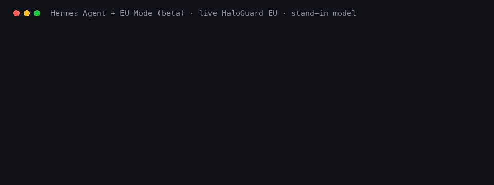

# EU Mode for Hermes Agent (beta)

EU Mode is a [Hermes Agent](https://github.com/NousResearch/hermes-agent) plugin. It connects your agent to HaloGuard EU, Astroware's guard API hosted in the EU.

- **Each message is checked.** EU Mode sends your message going in, and the model's reply going out, to HaloGuard EU. It answers allow or block.
- **Personal data in what you send is masked.** EU Mode looks for personal data in your messages, such as names and email addresses, and replaces what it finds with placeholders such as `[PERSON_1]` before the request reaches your model. When the reply comes back, EU Mode puts the originals back on your machine, so you read the real names.

This is a beta. We are looking for testers.

During the beta, use made-up data. Send no real personal data until your company has signed our DPA (Terms 10.3, astroware.ai/terms).



The demo calls the live HaloGuard EU API. The model in it is a stand-in on the same machine that prints what it received, so you can see the placeholder arrive. The name is made up.

## What happens to a message

```
you type:            "Draft an invite to Lena Vogt for Friday's lunch."
HaloGuard EU:        allow, and a masked copy of the conversation
your model gets:     "Draft an invite to [PERSON_1] for Friday's lunch."
your model replies:  "Hi [PERSON_1], are you free on Friday?"
HaloGuard EU:        checks the reply: allow
you read:            "Hi Lena Vogt, are you free on Friday?"
```

- **Masking happens only on a request going in**, that is, when the last message is a user message. A model reply going out is checked, and never masked.
- **A blocked message is not sent to your model.** You see `[EU Mode beta] HaloGuard EU blocked this message, so it was not sent to your model.` with the policy. The blocked message stays out of every later request in that session.
- **A blocked reply is not shown.** You see a notice instead.
- **Masking covers all kinds of personal data it finds (the default).**

## What is sent to HaloGuard EU

The text of your conversation so far: your messages and the model's replies. It is sent up to twice per turn: once ending with your message, and once ending with the model's reply.

Not sent: your system prompt, tool calls and tool results, files, images.

EU Mode identifies itself with the User-Agent `eu-mode-hermes/0.1`. EU Mode reads the key, `HALOGUARD_API_KEY`, through Hermes: from your Hermes `.env` or your environment, for the profile in use. EU Mode never logs or shows it, and sends it only over HTTPS (plain HTTP only to your own machine, for tests).

## What EU Mode does not cover

Please read this before you rely on it.

- **Only what you type is masked.** These reach your model as they are: your system prompt, tool results (web pages, files and command output the agent reads), Hermes memory added to your message, images and files.
- **The filter can miss personal data, and it can also mask words that are not personal data.**
- **Hermes' own side requests go around plugins.** Hermes sends some text to the model through a side channel that plugins cannot change (checked on Hermes 0.20.0):
  - automatic session titles send the first message of each session,
  - context compression sends earlier messages when a conversation gets long.

  Both are on by default. Switch them off (commands below). While one is on, EU Mode says so in the first reply of each session. EU Mode reads these two Hermes settings for that, and no other settings.
- **Streaming must be off.** With streaming on, the reply appears on screen before EU Mode checks it and before the originals are put back. Streaming is off by default on chat platforms (`streaming.enabled`); in the terminal, switch it off (command below).
- **Tool calls are not checked.** EU Mode checks messages and replies. It does not check or stop what the agent does with its tools.
- **A blocked message still costs one short model request.** Hermes has no way for a plugin to cancel a turn. So your model gets one request with a fixed note in place of the whole conversation, and no tools. Its answer is thrown away.
- **Placeholders must survive the model.** If your model rewrites a placeholder (for example `[PERSON 1]`), EU Mode cannot put the original back.
- **Very long conversations** can be more than one check accepts. EU Mode then tells you the message was not checked.

## When HaloGuard EU does not answer

EU Mode fails open. If HaloGuard EU does not answer in time, cannot be reached, or refuses the key, your message goes to your model **unchecked and not masked**. EU Mode never does this silently: the reply carries a line that says so.

If masking alone is unavailable, the guard check still runs and the reply says the message went to the model as written.

To hold a message back instead whenever it cannot be masked, set `EU_MODE_REQUIRE_MASKING=1`.

HaloGuard EU has no uptime guarantee, so it can be unavailable at times. That is one reason this is a beta.

## Install

You need Hermes Agent 0.20.0 or newer (tested with 0.20.0) and a HaloGuard EU beta key from Astroware.

During the beta, use made-up data. Send no real personal data until your company has signed our DPA (Terms 10.3, astroware.ai/terms).

1. Install and enable the plugin:

   ```bash
   hermes plugins install AstrowareAI/eu-mode-hermes --enable
   ```

   Hermes asks for `HALOGUARD_API_KEY` and saves it in your Hermes `.env`. You can also set it in your environment instead.

2. Switch off streaming and the two side requests:

   ```bash
   hermes config set display.streaming false
   ```

   ```bash
   hermes config set auxiliary.title_generation.enabled false
   ```

   ```bash
   hermes config set compression.enabled false
   ```

   With compression off, a very long conversation can reach your model's context limit. Start a new session when that happens.

3. If you use Hermes on a chat platform, restart the gateway:

   ```bash
   hermes gateway restart
   ```

4. Start Hermes and check the status:

   ```
   /eu-mode
   ```

   It shows whether the key is set (never the key itself) and the last decision.

5. Try it with a made-up name, for example `Draft an invite to Lena Vogt for Friday's lunch.` The reply ends with a line saying personal data found in your message was masked.

## Settings

All settings are environment variables.

| Variable | What it does | Default |
| --- | --- | --- |
| `HALOGUARD_API_KEY` | Your HaloGuard EU key. Required. | none |
| `HALOGUARD_BASE_URL` | The API address. | `https://api.astroware.ai/v1` |
| `EU_MODE_TIMEOUT` | Seconds to wait for HaloGuard EU before going on without it (0.5 to 30). | `5` |
| `EU_MODE_REQUIRE_MASKING` | `1`: hold a message back when it cannot be masked. | off |
| `EU_MODE_FOOTER` | `0`: leave out the line saying personal data found in your message was masked. Warnings always show. | on |

## Files EU Mode keeps

`<Hermes home>/eu-mode/blocked.json` holds a fingerprint (SHA-256) of each blocked message, so it stays out of later requests after a restart. It holds no message text. Only your user can read it.

## Switch it off or remove it

```bash
hermes plugins disable eu-mode
```

```bash
hermes plugins remove eu-mode
```

## Run the tests

The tests use a fake HaloGuard EU on your machine and made-up data only. No key is needed.

```bash
python3 -m unittest discover -s tests -v
```

## Feedback

Beta testers: please open an issue on this repository. Tell us what you ran, what you expected and what happened. Never paste your key or real personal data into an issue.

## License

Apache License 2.0. See [LICENSE](LICENSE).
